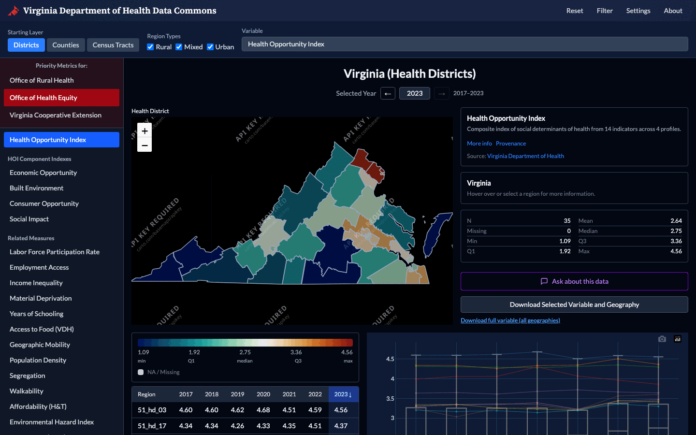
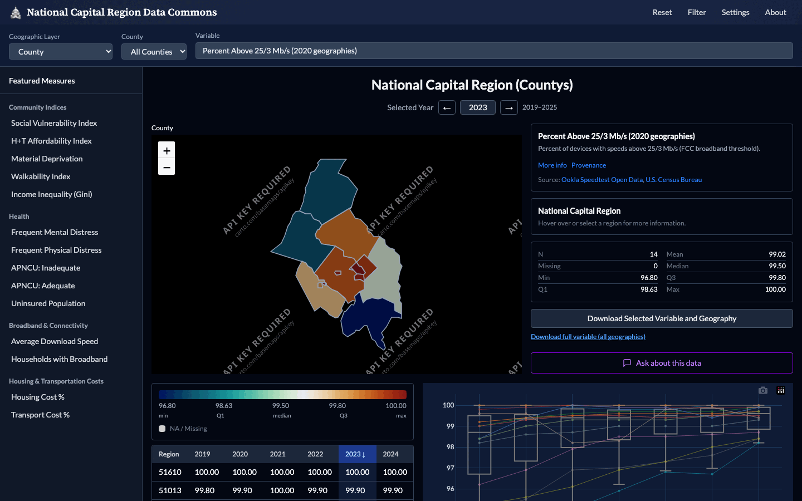
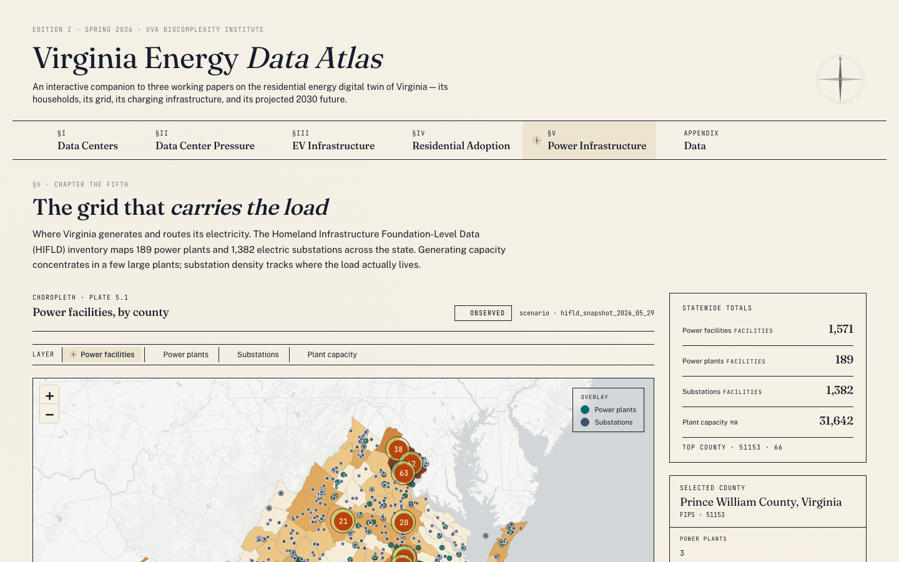

# Dashboards

Measures in the commons are published on three interactive dashboards. All
three are lightweight static web applications, built with Next.js, React,
TypeScript, Leaflet, Plotly.js, and Tailwind CSS, with no backend at runtime.

The two regional indicator dashboards, for Virginia and for the National
Capital Region, share one data format and one codebase pattern, so a measure
prepared for one is prepared in the same shape for the other. On either of
them you can:

- map a measure at any available geographic level and step or animate it
  through time;
- compare regions with scatter, bar, and box plots;
- filter and sort regions, and read summary statistics for the selection;
- open the full metadata, source, and provenance of a measure;
- download the selected variable and geography, or the full variable across
  all geographies.

## Virginia Department of Health Data Commons

[:octicons-arrow-right-24: dads2busy.github.io/virginia_public_health_data](https://dads2busy.github.io/virginia_public_health_data/){ .md-button .md-button--primary }

Built for the Virginia Department of Health to support its strategic plans,
with priority measures for the Office of Rural Health, the Office of Health
Equity, and Virginia Cooperative Extension.

| | |
| --- | --- |
| **Coverage** | All of Virginia |
| **Geographies** | Health districts, counties, census tracts, with rural, mixed, and urban region types |
| **Featured measure** | The Health Opportunity Index and its component indexes: economic opportunity, built environment, consumer opportunity, and social impact |
| **Related measures** | Labor force participation, employment access, income inequality, material deprivation, years of schooling, access to food, geographic mobility, population density, segregation, walkability, housing and transportation affordability, environmental hazard, access to care, incarceration, and more |

## National Capital Region Data Commons

[:octicons-arrow-right-24: dads2busy.github.io/national_capital_region_data](https://dads2busy.github.io/national_capital_region_data/){ .md-button .md-button--primary }

The successor to the original Social Impact Data Commons dashboard for the
National Capital Region, developed with the Mastercard Center for Inclusive
Growth and grounded in the questions of stakeholders in Arlington and Fairfax
Counties.

| | |
| --- | --- |
| **Coverage** | The District of Columbia and the surrounding counties in Virginia and Maryland |
| **Geographies** | Counties, census tracts, block groups, and local shapes such as civic associations, zip codes, planning districts, supervisor districts, and human services regions |
| **Measure groups** | Community indices (Social Vulnerability Index, H+T Affordability Index, material deprivation, walkability, income inequality), health (mental and physical distress, insurance, prenatal care adequacy), broadband and connectivity, housing and transportation costs, and more |

## Virginia Energy Data Atlas

[:octicons-arrow-right-24: va-energy-data.policy-analytics.net](https://va-energy-data.policy-analytics.net/){ .md-button .md-button--primary }

An interactive companion to the UVA Biocomplexity Institute's research on a
residential energy digital twin of Virginia: its households, its grid, its
charging infrastructure, and its projected 2030 future. Where the regional
dashboards follow indicators across years, the atlas is organized as chapters,
and its data adds time stamps down to the hour, scenarios, and point-level
facility layers.

| | |
| --- | --- |
| **Coverage** | All of Virginia |
| **Geographies** | Counties and census tracts, with point overlays for individual facilities and charging stations |
| **Chapters** | Data centers (existing), data center pressure (projected siting under 20 CERF scenarios), EV infrastructure (charging stations and hourly demand), residential adoption (household EV and solar adoption with PV generation), and power infrastructure (power plants and electric substations) |
| **Observed and simulated data** | Data center, power plant, and substation layers are observed records (IM3 and HIFLD). EV charging, residential adoption, and projected data center layers are simulation or scenario outputs and are labeled as such in their metadata |
| **Linked data** | Every layer is also published as an RDF knowledge graph, downloadable from the atlas's Data appendix |

## Data behind the dashboards

The per-level files each dashboard loads are committed to the
[`dashboard_data/`](https://github.com/dads2busy/Social-Data-Commons/tree/main/dashboard_data)
directory of the repository, next to the long-format distribution files and
`measure_info.json` metadata that produced them. See
[How datasets are built](../about/approach.md#how-datasets-are-built) for the
pipeline that generates them.
